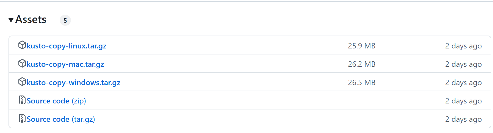

# 🚀 Setup guide

[Documentation home](README.md) | [CLI reference](parameters.md) | [Common scenarios](scenarios.md)

From download to your first validated table copy.

**Your path:** [Prepare](#prerequisites) · [Download](#download-kusto-copy-cli) ·
[Grant access](#permissions) · [Run](#running-the-tool) · [Validate](#validating-the-copy)

<a id="prerequisites"></a>

## ✅ Prerequisites

*   A source Kusto cluster (either Azure Data Explorer or Fabric Eventhouse)
    * Default workload group should be strongly consistent
*   A destination Kusto cluster (either Azure Data Explorer or Fabric Eventhouse)
*   An ADLS gen 2 storage account
    * Soft Delete shouldn't be enabled
*   Somewhere to run the Kusto Copy CLI (e.g. a laptop, Cloud Shell, etc.)

<a id="download-kusto-copy-cli"></a>

## 📥 Download Kusto Copy CLI

1. Open the [releases page](https://github.com/Azure/kusto-copy/releases), newest release first.
2. Download the package for your OS: **Linux, macOS, or Windows**.
3. Extract the package to make the CLI available.



<a id="permissions"></a>

## 🔐 Permissions

Kusto Copy runs with a Microsoft Entra ID identity that needs to:

* Execute queries on the source database
* Ingest data, create temporary tables and run queries on the destination database
* Generate read/write SAS tokens for staging exports and ingestion, and write tracking data

> [!TIP]
> Kusto Copy uses [DefaultAzureCredential][credential]. An Azure CLI login can be used for
> local trials. For long-running or unattended jobs, prefer a **managed identity**.

### Source Database permissions

There are two ways to assign the **viewer role** to a principal:

* Control Plane
    * You can do it from the portal via the permission pane
    * Through Azure CLI
    * Through PowerShell
* Data Plane
    * By [running KQL commands][database-roles]

The minimum scope is the **source database**; cluster-level assignment is not required.

### Destination Database permissions

Assign **admin** permission at the **destination database** level.

Use the same assignment methods described above.

### ADLS Gen2 container permissions

Assign **Storage Blob Data Contributor** on the staging container (or a parent scope).
Also grant permission to request a user delegation key at the storage account level or
above, for example with **Storage Blob Delegator** on the storage account. Assigning
Delegator only on a container does not grant that account-level operation.

See [authentication and security](advanced.md#authentication-and-security) for managed
identities, service principals, and network access.

<a id="preparing-the-destination-table"></a>

## 🗃️ Preparing the destination table

> [!IMPORTANT]
> Kusto Copy **does not create the destination table**. Create it first with a schema
> compatible with the data exported from the source table.

<a id="running-the-tool"></a>

## ▶️ Running the tool

Replace the example endpoints, database, table, and staging folder:

```bash
kc -s https://mycluster.eastus.kusto.windows.net/mydb/mytable \
   -d https://yourcluster.eastus.kusto.windows.net/yourdb/ \
   -t https://mystorageaccount.blob.core.windows.net/mycontainer/myfolder
```

*Shell tip:* `\` is Bash continuation syntax. In PowerShell, use one line or backticks.

See [Parameters](parameters.md) for details about the CLI's parameters.

<a id="progress"></a>

## 📊 Progress

See [Reading progress](progress.md) to interpret the copy's progress.

<a id="validating-the-copy"></a>

## 🔎 Validating the copy

Always validate the result, not just the process exit status:

- **Compare row counts** for the same selected dataset.
- **Compare aggregates** that return a small result, such as an average or totals by time bucket.
- Follow the [production checklist](advanced.md#production-checklist) for a larger migration.

<a id="next-steps"></a>

## 🧭 Next steps

- [Common scenarios](scenarios.md): multiple tables, filtering, and incremental copies.
- [Troubleshooting & performance](troubleshooting.md): errors, stalls, and capacity tuning.
- [Advanced topics](advanced.md): pipeline behavior, resume, security, and production checks.

[credential]: https://learn.microsoft.com/dotnet/api/azure.identity.defaultazurecredential
[database-roles]: https://learn.microsoft.com/kusto/management/manage-database-security-roles
